# Implementación real del flujo de eventos y Outbox

## Objetivo

Java es dueño de la operación de negocio y de la persistencia del evento. C# recibe el evento confirmado mediante HTTP y lo retransmite a React mediante SignalR.

```mermaid
flowchart LR
    A[Java: puja o cierre] --> B[Transacción de negocio]
    B --> C[(OUTBOX_EVENT)]
    C --> D[OutboxEventWorker]
    D --> E[RealtimeEventPublisher]
    E -->|POST + X-Internal-Api-Key| F[C# InternalAuctionEventsController]
    F --> G[AuctionEventRelayService]
    G --> H[Deduplicación por eventId]
    H --> I[Grupo SignalR Auction_ID]
    I --> J[React]
```



## Analogía

El Outbox funciona como una oficina de correo:

1. Java confirma la operación y deja el mensaje en una bandeja.
2. El mensaje se guarda junto con la operación de negocio.
3. Un trabajador revisa la bandeja cada cinco segundos.
4. Si C# responde, el mensaje se marca como enviado.
5. Si C# está caído, el mensaje permanece pendiente y se reintenta.
6. Si se agotan los intentos, queda como fallido para inspección.

## Persistencia en Java

La puja y el evento se guardan dentro de la misma transacción. `AuctionServiceImpl` construye un `AuctionEvent` y llama a `OutboxService.enqueue` antes del commit.

```java
AuctionEvent newBidEvent = new AuctionEvent(
    eventIdNewBid,
    savedAuction.getId().longValue(),
    "NewBid",
    savedAuction.getCurrentPrice(),
    savedAuction.getCurrentWinnerId().longValue(),
    "User_" + savedAuction.getCurrentWinnerId(),
    savedAuction.getEndDateUtc().atOffset(ZoneOffset.UTC),
    timestampUtc,
    null,
    null,
    null,
    savedAuction.getStatus(),
    "User_" + savedAuction.getCurrentWinnerId()
);

outboxService.enqueue(newBidEvent);
```

`OutboxService` serializa el evento y guarda:

```text
eventId
eventType
aggregateId
payloadJson
status
attempts
nextAttemptAt
createdAtUtc
sentAtUtc
lastError
```

## Worker y reintentos

`OutboxEventWorker` consulta eventos `PENDING` cuya fecha `nextAttemptAt` ya venció:

```java
@Scheduled(fixedDelayString = "${subastaya.outbox.poll-delay-ms:5000}")
@Transactional
public void processOutboxEvents() {
    LocalDateTime now = LocalDateTime.now(ZoneOffset.UTC);
    List<OutboxEvent> pending = repository
        .findTop100ByStatusAndNextAttemptAtLessThanEqualOrderByCreatedAtUtcAsc(
            "PENDING", now);

    for (OutboxEvent event : pending) {
        process(event);
    }
}
```

Estados:

```text
PENDING -> SENT
PENDING -> PENDING -> PENDING
PENDING -> FAILED
```

Backoff configurado:

```text
1 segundo, 5 segundos, 30 segundos, 2 minutos y 10 minutos
```

## Comunicación Java -> C#

`RealtimeEventPublisher` envía:

```http
POST /api/internal/auctions/notify-event
Content-Type: application/json
X-Internal-Api-Key: dev-secret
```

Ejemplo de payload:

```json
{
  "eventId": "uuid",
  "auctionId": 1,
  "eventType": "NewBid",
  "newAmount": 150,
  "bidderId": 2,
  "bidderUsername": "Buyer One",
  "eventTimestampUtc": "2026-11-07T01:30:00Z",
  "auctionStatus": "ACTIVE"
}
```

Una respuesta `202 Accepted` marca el evento como `SENT`. Los errores de red, `5xx`, `408` y `429` provocan reintento. Los errores de contrato se conservan en `lastError`.

## Recepción en C#

C# no consulta la tabla Outbox. Recibe el evento por HTTP:

```csharp
[HttpPost("notify-event")]
public async Task<IActionResult> NotifyEvent(
    [FromBody] AuctionEventRequest request,
    CancellationToken cancellationToken)
{
    var configuredApiKey = _configuration["InternalApiKey"];

    if (string.IsNullOrWhiteSpace(configuredApiKey))
        configuredApiKey = Environment.GetEnvironmentVariable("INTERNAL_API_KEY");

    var errors = request.Validate();
    if (errors.Count > 0)
        return ValidationProblem(new ValidationProblemDetails(errors));

    var relayed = await _relayService.ProcessAsync(
        notification,
        cancellationToken);

    return Accepted(new {
        eventId = notification.EventId,
        status = relayed ? "Relayed" : "Duplicate"
    });
}
```

`AuctionEventRelayService` valida los tipos permitidos, evita eventos repetidos por `eventId` y delega a SignalR:

```csharp
switch (notification.EventType)
{
    case "NewBid":
        await _notificationService.NotifyNewBidAsync(notification, cancellationToken);
        break;
    case "Extended":
        await _notificationService.NotifyTimeExtendedAsync(notification, cancellationToken);
        break;
    case "Closed":
        await _notificationService.NotifyAuctionClosedAsync(notification, cancellationToken);
        break;
}
```

## SignalR y React

Los eventos se publican al grupo:

```text
Auction_{auctionId}
```

Eventos expuestos:

```text
ReceiveNewBid
AuctionTimeExtended
AuctionClosed
```

React se une al grupo usando `JoinAuctionGroup` y actualiza precio, fecha de cierre, ganador y estado final.

## Esquema y migraciones

La tabla `OUTBOX_EVENT` es creada por C# mediante la migración EF Core `AddOutboxEvent`. C# mantiene la autoridad sobre la creación del esquema; Java mantiene la autoridad sobre el contenido y el procesamiento de los eventos.

La tabla incluye:

```text
ID BIGINT identity
EVENT_ID UUID UNIQUE
EVENT_TYPE VARCHAR(32)
AGGREGATE_ID BIGINT
PAYLOAD_JSON TEXT
STATUS VARCHAR(16)
ATTEMPTS INTEGER
NEXT_ATTEMPT_AT TIMESTAMP
CREATED_AT_UTC TIMESTAMP
SENT_AT_UTC TIMESTAMP NULL
LAST_ERROR VARCHAR(1000) NULL
```

## Alineación Java-C# realizada

- `AuditLog` Java usa `ID` integer, `ACTION`, `PERFORMED_BY`, `DETAILS` y `TIMESTAMP`.
- `Category` Java ya no espera una columna `VERSION` inexistente.
- `TransactionLedger` Java usa `CREATED_AT`, igual que la migración EF Core.
- El Outbox usa la tabla `OUTBOX_EVENT` compartida.
- Los estados de subasta se normalizan como `ACTIVE`, `SCHEDULED`, `FINISHED` y `NO_SALE`.

## Archivos principales

- `microservice-java/src/main/java/org/example/service/OutboxService.java`
- `microservice-java/src/main/java/org/example/service/worker/OutboxEventWorker.java`
- `microservice-java/src/main/java/org/example/integration/RealtimeEventPublisher.java`
- `microservice-java/src/main/java/org/example/domain/entities/OutboxEvent.java`
- `backend/SubastaYa/SubastaYa.Domain/Entities/OutboxEvent.cs`
- `backend/SubastaYa/SubastaYa.Infrastructure/Configurations/OutboxEventConfiguration.cs`
- `backend/SubastaYa/SubastaYa.Infrastructure/Persistence/Migrations/20261107043735_AddOutboxEvent.cs`
- `backend/SubastaYa/SubastaYa.Api/Controllers/InternalAuctionEventsController.cs`

## Verificación

- La compilación C# es correcta cuando no hay una instancia previa de `SubastaYa.Api` bloqueando el ejecutable.
- Java compila las clases, pero necesita que la migración C# haya creado `OUTBOX_EVENT` antes de validar Hibernate.
- Los archivos `.env` locales están ignorados por Git y no se suben al repositorio.
