# Implementación real de SubastaYa

## 1. Propósito del sistema

SubastaYa es una plataforma de subastas con:

- catálogo filtrable;
- creación y publicación de subastas;
- pujas en tiempo real;
- billetera con saldo total, retenido y disponible;
- garantía de fondos mediante Escrow;
- regla Anti-Sniping;
- cierre automático;
- auditoría y libro contable;
- sincronización React <- SignalR/C# <- Java;
- persistencia confiable de eventos mediante Outbox.

Los requerimientos funcionales y no funcionales de este relevamiento se basan en `Requerimientos.pdf` y `Practica_SubastaYa.pdf`.

## 2. Arquitectura general

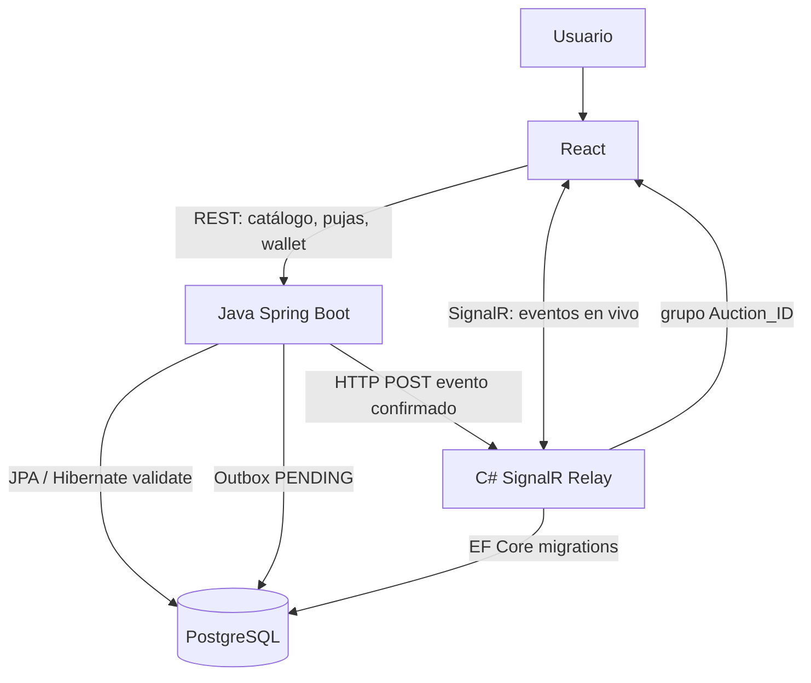

### Analogía arquitectónica

Java es la caja fuerte donde se decide si una puja es válida. C# es el altavoz que anuncia el resultado. React es la pantalla que muestra lo anunciado.

C# no debe decidir quién gana ni modificar saldos cuando recibe un evento. Sólo valida el contrato y comunica el resultado por SignalR.

## 3. Requerimientos de negocio

### RN1 - Solvencia y confianza

Toda puja válida debe estar respaldada por fondos reales retenidos.

Analogía: es como dejar una garantía antes de reservar un producto. El usuario puede seguir viendo su saldo, pero la parte retenida ya no está disponible para otra operación.

### RN2 - Juego limpio

Una puja en los últimos 60 segundos extiende la subasta dos minutos. Esto evita que una oferta llegue en el último instante sin dar posibilidad de respuesta a los demás participantes.

### RN3 - Trabajo colaborativo auditable

El historial Git, los commits y la separación de responsabilidades permiten verificar la participación de ambos integrantes.

## 4. Requerimientos de usuario

| Código | Capacidad | Implementación relacionada |
|---|---|---|
| RU1 | Filtrar por estado, categoría y precio | Catálogo React/API |
| RU2 | Tarjetas con precio, pujas y contador | `AuctionCard.jsx`, `AuctionTimer.jsx` |
| RU3 | Crear subastas | Controlador/servicio de creación |
| RU4 | Ver cambios sin refrescar | SignalR y `useAuctionSocket.js` |
| RU5 | Pujar con monto sugerido o personalizado | `handleBidSubmit`, `BidsController`/Java |
| RU6 | Ver total, retenido y disponible | Wallet y contexto React |
| RU7 | Depositar saldo ficticio y consultar historial | Wallet/Ledger |
| RU8 | Ver compras, pujas y publicaciones | Módulo de actividades |

## 5. RF1 - Escrow y billetera

### Flujo funcional

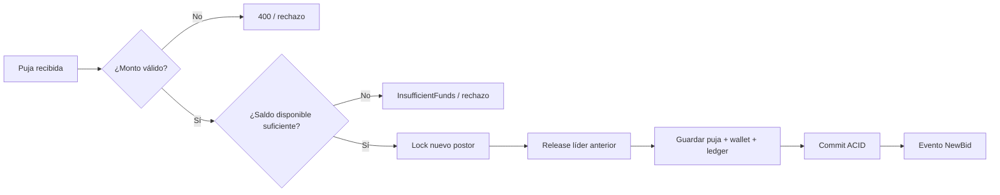

### Analogía

Dos personas compiten por una reserva. Cuando la segunda supera a la primera, el sistema libera la garantía de la primera y congela la garantía de la segunda dentro de la misma operación. Nunca debe quedar el dinero de ambas personas bloqueado por error.

### Implementación Java

En `WalletServiceImpl.processBidGuarantee` se ejecuta la lógica de retención y liberación. `AuctionServiceImpl.placeBid` está anotado con aislamiento `SERIALIZABLE`:

```java
@Transactional(isolation = Isolation.SERIALIZABLE)
public Auction placeBid(Integer auctionId, Integer bidderId, BigDecimal amount) {
    // valida subasta, monto y fecha
    walletService.processBidGuarantee(
        auctionId,
        previousWinnerId,
        bidderId,
        previousPrice,
        amount
    );

    auction.setCurrentWinnerId(bidderId);
    auction.setCurrentPrice(amount);
    auctionRepository.saveAndFlush(auction);
}
```

En C# existe el camino equivalente en `BidService.PlaceBidAsync`, que bloquea el nuevo saldo, libera el anterior y guarda puja y ledger dentro de una transacción. El frontend actual utiliza el proxy de Vite hacia Java, por lo que debe definirse una única autoridad antes de una prueba productiva.

## 6. Dos pujantes al mismo tiempo

### Situación

Dos usuarios leen simultáneamente el mismo precio y envían el mismo monto.

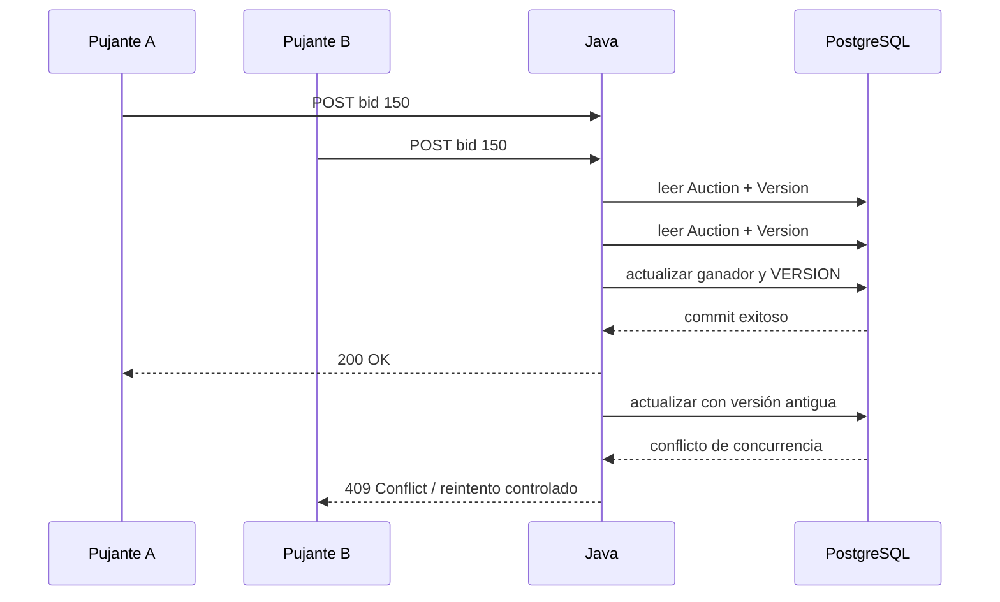

### Analogía

Es como dos personas intentando escribir en la misma línea de un libro. La primera que confirma conserva la línea; la segunda descubre que la página cambió y debe volver a leer antes de intentar otra vez.

### Implementación real

La entidad tiene un campo `VERSION` con `@Version` en Java y `IsConcurrencyToken()`/`ConcurrencyCheck` en C#.

```java
@Version
@Column(name = "VERSION")
private Long version;
```

```csharp
[ConcurrencyCheck]
[Column("VERSION")]
public uint Version { get; set; }
```

El middleware C# transforma `DbUpdateConcurrencyException` y `ConcurrencyConflictException` en HTTP `409 Conflict`.

La UI muestra un aviso de conflicto para que el usuario actualice el estado de la subasta.

## 7. RF2.1 - Anti-Sniping

### Flujo

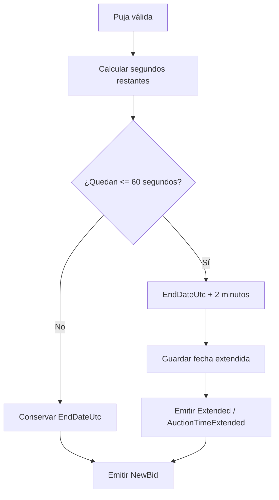

### Analogía

Es el alargue de una final deportiva: si alguien marca una jugada decisiva cuando el reloj está por terminar, se agrega tiempo para que el resto pueda responder.

### Código

```java
long secondsLeft = Duration.between(
    nowUtc.toLocalDateTime(),
    auction.getEndDateUtc()
).toSeconds();

if (secondsLeft <= 60) {
    auction.setEndDateUtc(
        auction.getEndDateUtc().plusMinutes(2)
    );
    timeExtended = true;
}
```

El frontend no suma dos minutos localmente. Usa la fecha recibida como fuente de verdad:

```javascript
const handleTimeExtended = useCallback(
  (auctionIdReceived, newEndDate, reason) => {
    if (Number(auctionIdReceived) !== Number(auctionId)) return;
    onAntiSnipingExtend(newEndDate);
    addToast('Subasta extendida', 'warning');
  },
  [auctionId, onAntiSnipingExtend, addToast]
);
```

## 8. RF2.2 y RF2.3 - monto sugerido y liderazgo

El próximo monto se calcula como:

```text
Puja actual + Incremento mínimo
```

```java
BigDecimal minRequired = auction.getCurrentPrice()
    .add(auction.getMinIncrement());

if (amount.compareTo(minRequired) < 0) {
    throw new IllegalArgumentException(
        "Bid amount must be at least current price plus minimum increment."
    );
}
```

El frontend mantiene el estado visual:

```javascript
if (isCurrentBidMine) return 'leading';
if (prevStatus === 'leading') return 'outbid';
```

### Analogía

El usuario ve un tablero de carrera: una luz verde indica que va primero; cuando otro participante lo supera, la luz cambia a rojo y recibe una notificación.

## 9. RF3 - worker y cierre automático

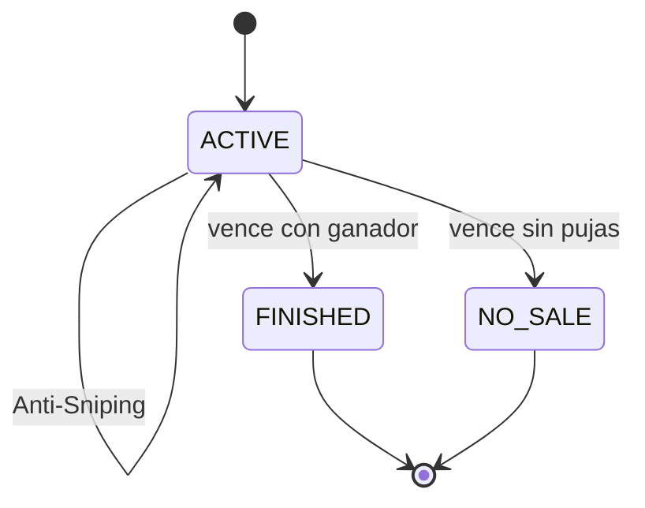

`AuctionExpirationWorker` utiliza `ThreadPoolTaskScheduler`, recupera subastas activas al iniciar y programa cierres exactos por fecha.

```java
@EventListener(ApplicationReadyEvent.class)
public void initializeSchedules() {
    // carga subastas expiradas y activas
    // liquida las vencidas
    // agenda las futuras
}
```

### Cierre con ganador

1. Se identifica el ganador.
2. Se debita el Escrow del comprador.
3. Se acredita al vendedor.
4. Se registra el ledger.
5. Se marca la subasta como `FINISHED`.
6. Se guarda un evento `Closed` en el Outbox.

### Cierre sin ganador

1. No se transfiere dinero.
2. Se marca `NO_SALE`.
3. Se registra el cierre.
4. Se emite `Closed` con ganador nulo.

## 10. RF4 - auditoría y ledger

El Ledger responde a la pregunta: “¿qué movimiento de dinero ocurrió?”.

El Audit Log responde a: “¿qué decisión o evento del sistema ocurrió?”.

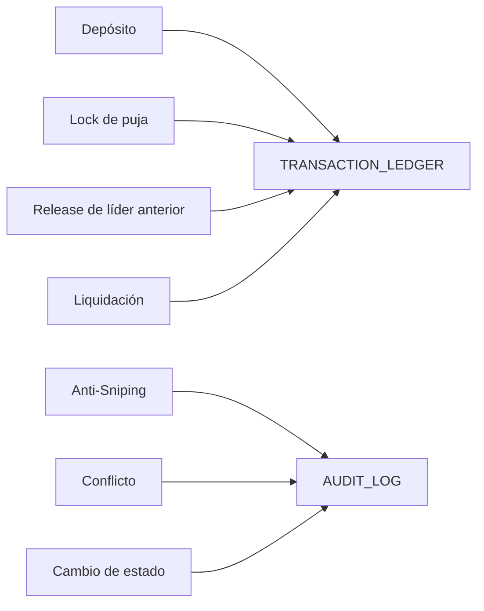

La entidad Java se alineó con el esquema C#:

```text
AUDIT_LOG.ID
AUDIT_LOG.ACTION
AUDIT_LOG.PERFORMED_BY
AUDIT_LOG.DETAILS
AUDIT_LOG.TIMESTAMP
```

El `AuditServiceImpl` guarda el `auctionId`, usuario, estado anterior, estado nuevo y mensaje dentro de `DETAILS`.

## 11. Outbox y entrega confiable

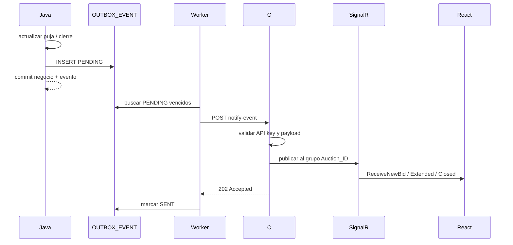

Si C# está apagado:

```text
PENDING -> reintento 1
PENDING -> reintento 2
PENDING -> reintento 3
PENDING -> FAILED
```

Esto evita que una puja confirmada desaparezca sólo porque el relay no estaba disponible.

## 12. Cómo React sabe quién ganó

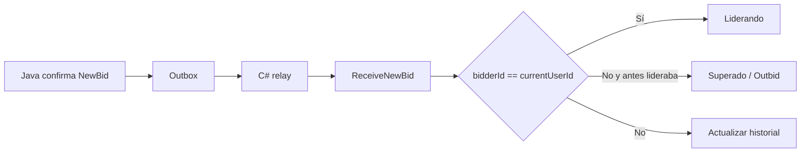

Código real del hook:

```javascript
const handleIncomingBid = useCallback(
  (auctionIdReceived, amount, bidderUsername, timestamp, bidderId) => {
    if (Number(auctionIdReceived) !== Number(auctionId)) return;

    setCurrentPrice(amount);

    const isCurrentBidMine = bidderId === currentUserId;

    setLeadershipStatus((previousStatus) => {
      if (isCurrentBidMine) return 'leading';
      if (previousStatus === 'leading') return 'outbid';
      return previousStatus;
    });
  },
  [auctionId, currentUserId]
);
```

El cliente SignalR se registra para:

```javascript
connection.on('ReceiveNewBid', handlers.onNewBid);
connection.on('AuctionTimeExtended', handlers.onTimeExtended);
connection.on('AuctionClosed', handlers.onAuctionClosed);
```

## 13. Reconexión

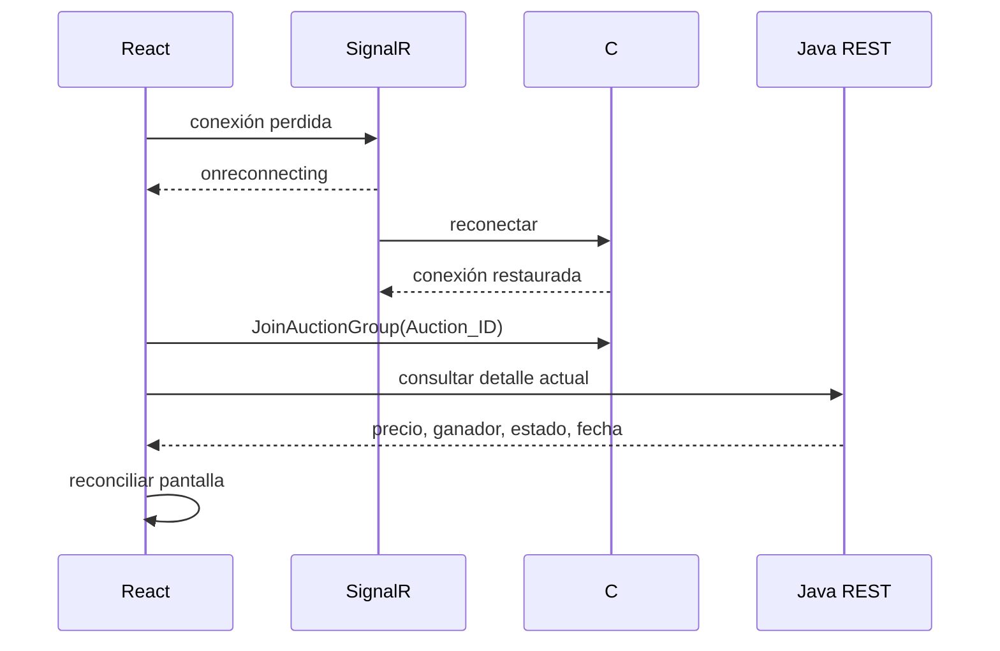

La reconexión vuelve a ejecutar `JoinAuctionGroup`. El detalle REST debe utilizarse como fuente de reconciliación si se perdió un evento durante la desconexión.

## 14. Catálogo, API y UX

Endpoints contemplados por la práctica:

```text
GET  /api/auctions
GET  /api/auctions/{id}
POST /api/auctions
POST /api/auctions/{id}/bids
GET  /api/wallet/balance
POST /api/wallet/deposit
```

La API debe responder con códigos representativos:

| Situación | Código esperado |
|---|---:|
| Operación exitosa | 200 / 201 |
| Evento aceptado por relay | 202 |
| Datos inválidos | 400 |
| Falta de autenticación interna | 401 |
| Recurso inexistente | 404 |
| Colisión de concurrencia | 409 |
| Error inesperado | 500 |

La UI debe mostrar spinners, errores de saldo, monto inválido, conflicto, reconexión y cierre de subasta.

## 15. Persistencia y coexistencia poliglota

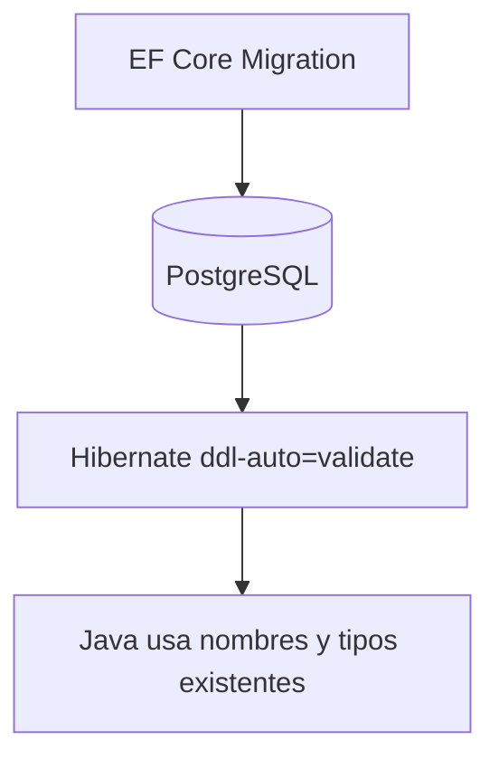

C# crea y actualiza el esquema mediante EF Core. Java valida el esquema existente mediante:

```properties
spring.jpa.hibernate.ddl-auto=validate
```

Por eso fueron necesarias estas alineaciones:

- `AuditLog.ID`: Java `Integer`, no `Long`.
- `AuditLog`: `ACTION`, `PERFORMED_BY`, `DETAILS`, `TIMESTAMP`.
- `Category`: no espera `VERSION`.
- `TransactionLedger`: usa `CREATED_AT`.
- Outbox: tabla `OUTBOX_EVENT` creada por migración EF Core.

## 16. Seed y casos de prueba

El `SeedData` de C# crea en Development:

```text
4 usuarios
4 categorías
4 wallets
5 subastas
1 puja inicial
1 movimiento de ledger
```

Incluye estados:

```text
ACTIVE
SCHEDULED
FINISHED
NO_SALE
```

### Gráfico de escenarios

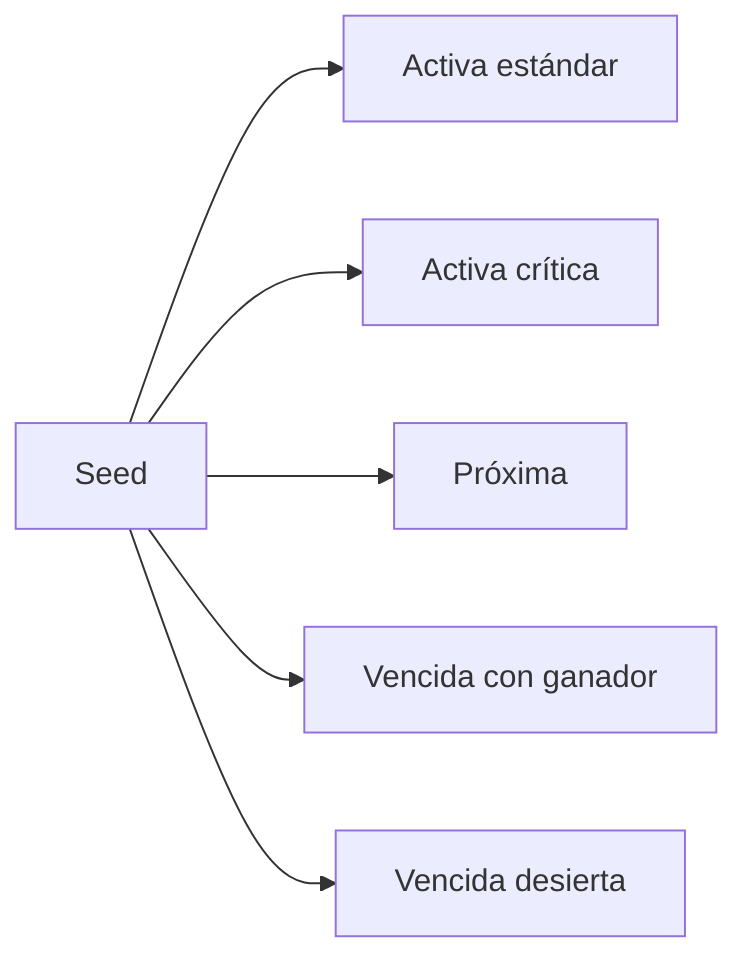

El seed es idempotente para no duplicar usuarios, categorías, wallets ni subastas en reinicios normales de Development.

## 17. Prueba de concurrencia requerida

```powershell
$bodyA = '{"bidderId":2,"amount":150000}'
$bodyB = '{"bidderId":3,"amount":150000}'

Start-Job { Invoke-WebRequest http://localhost:8080/api/auctions/1/bids -Method Post -ContentType 'application/json' -Body $using:bodyA }
Start-Job { Invoke-WebRequest http://localhost:8080/api/auctions/1/bids -Method Post -ContentType 'application/json' -Body $using:bodyB }
```

Resultado esperado:

```text
Una puja confirmada.
Una puja rechazada, reintentable o 409 Conflict.
Un único ganador.
Wallets y ledger consistentes.
```

## 18. Estado de cumplimiento

| Área | Estado actual | Observación |
|---|---|---|
| Escrow | Implementado en servicios | Debe validarse end-to-end |
| Anti-Sniping | Implementado | Fecha efectiva viaja en evento |
| Concurrencia | Implementada | Version + transacción + 409 |
| Worker de cierre | Implementado | Requiere prueba con fechas reales |
| Audit Log | Alineado al esquema C# | Registra detalles semánticos |
| Ledger | Implementado en servicios | Requiere auditoría de saldos |
| Outbox | Implementado | Persistencia, retry y estados |
| SignalR | Implementado | Relay por grupo de subasta |
| Reconexión | Parcial | Rejoin implementado; reconciliación REST debe probarse |
| Stress test | Pendiente de evidencia | Falta guardar resultados HTTP, SQL y logs |

## 19. Archivos principales

### Java

- `microservice-java/src/main/java/org/example/service/impl/AuctionServiceImpl.java`
- `microservice-java/src/main/java/org/example/service/impl/WalletServiceImpl.java`
- `microservice-java/src/main/java/org/example/service/worker/AuctionExpirationWorker.java`
- `microservice-java/src/main/java/org/example/service/worker/OutboxEventWorker.java`
- `microservice-java/src/main/java/org/example/service/OutboxService.java`
- `microservice-java/src/main/java/org/example/integration/RealtimeEventPublisher.java`
- `microservice-java/src/main/java/org/example/domain/entities/OutboxEvent.java`
- `microservice-java/src/main/java/org/example/domain/entities/Auction.java`

### C#

- `backend/SubastaYa/SubastaYa.Api/Controllers/BidsController.cs`
- `backend/SubastaYa/SubastaYa.Api/Controllers/InternalAuctionEventsController.cs`
- `backend/SubastaYa/SubastaYa.Api/Hubs/AuctionHub.cs`
- `backend/SubastaYa/SubastaYa.Api/Hubs/AuctionNotificationService.cs`
- `backend/SubastaYa/SubastaYa.Infrastructure/Services/BidService.cs`
- `backend/SubastaYa/SubastaYa.Infrastructure/Services/WalletService.cs`
- `backend/SubastaYa/SubastaYa.Infrastructure/Services/AuctionEventRelayService.cs`
- `backend/SubastaYa/SubastaYa.Infrastructure/Persistence/SeedData.cs`
- `backend/SubastaYa/SubastaYa.Infrastructure/Persistence/Migrations/20261107043735_AddOutboxEvent.cs`

### Frontend

- `frontend/src/Hooks/useAuctionSocket.js`
- `frontend/src/Services/AuctionHub.js`
- `frontend/src/components/Auction/AuctionRoom.jsx`
- `frontend/src/components/Auction/AuctionCard.jsx`

## 20. Conclusión

El comportamiento crítico se resume así:

```text
validar puja
-> bloquear fondos
-> liberar líder anterior
-> aplicar Anti-Sniping
-> guardar negocio y auditoría
-> guardar evento Outbox
-> commit
-> enviar a C#
-> publicar SignalR
-> actualizar React
```

La propiedad más importante es que la decisión de negocio se confirma antes de depender de SignalR. Si C# o React están temporalmente desconectados, la puja no se pierde y el estado puede reenviarse o reconciliarse.
