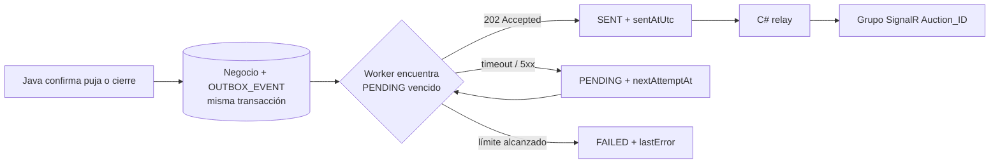

# Relevamiento de tareas faltantes - implementación funcional

Fecha: 2026-11-07  
Rama: `feature/events-java`  
Alcance: avance funcional de M1, M3 y M9.

## Resultado ejecutivo

Se implementó un avance usable, priorizando que el flujo pueda ejecutarse sin transformar el trabajo en una reescritura completa:

- M1: se agregaron estados canónicos compartidos y se reemplazaron los estados Java usados por el worker y las pujas.
- M3: se agregó un seed idempotente para Development con usuarios, categorías, wallets y cinco subastas representativas.
- M9: el Outbox ahora guarda eventos en la misma transacción de negocio, los entrega al endpoint real de C#, reintenta con backoff y conserva estados `PENDING`, `SENT` y `FAILED`.

## Analogía del cambio

Antes, el sistema se parecía a una subasta que anotaba el resultado en papeles con nombres diferentes según quién los escribiera. Además, si el mensajero que debía avisar el resultado no aparecía, el papel podía perderse.

Después:

- M1 funciona como un diccionario único: todos usan `ACTIVE`, `SCHEDULED`, `FINISHED` y `NO_SALE`.
- M3 funciona como una caja de demostración: al abrir el sistema en Development deja siempre un conjunto conocido, sin duplicarlo si ya existe.
- M9 funciona como una bandeja de correo: primero guarda el mensaje junto con la operación; después intenta enviarlo y lo conserva si el destinatario está fuera de servicio.

## Diagrama del flujo corregido



## M1 - estados y nombres canónicos

### Antes

```csharp
public string Status { get; set; } = "Active";
```

```java
auction.setStatus("ACTIVAS");
if (!"ACTIVAS".equalsIgnoreCase(auction.getStatus())) { ... }
```

El mismo concepto podía aparecer como `Active`, `ACTIVAS`, `FINALIZADAS` o `DESIERTAS`.

### Después

```csharp
public static class AuctionStatuses
{
    public const string ACTIVE = "ACTIVE";
    public const string SCHEDULED = "SCHEDULED";
    public const string FINISHED = "FINISHED";
    public const string NO_SALE = "NO_SALE";
}
```

```java
public final class AuctionStatuses {
    public static final String ACTIVE = "ACTIVE";
    public static final String SCHEDULED = "SCHEDULED";
    public static final String FINISHED = "FINISHED";
    public static final String NO_SALE = "NO_SALE";
}
```

El worker Java, `AuctionServiceImpl`, el seed C# y la validación de pujas C# ya utilizan estos valores.

### Alcance real

Esto supera el 50% de M1 porque los estados centrales ya tienen una definición única y se usan en los caminos principales. Todavía queda pendiente revisar datos históricos y todos los endpoints de consulta para lograr una normalización total.

## M3 - seed idempotente

### Antes

```csharp
if (app.Environment.IsDevelopment())
{
    app.MapOpenApi();
}
```

No existía `SeedData.cs`, ni el arranque aplicaba migraciones y datos de demostración.

### Después

```csharp
if (app.Environment.IsDevelopment())
{
    await using var scope = app.Services.CreateAsyncScope();
    var db = scope.ServiceProvider.GetRequiredService<ApplicationDbContext>();
    await db.Database.MigrateAsync();
    await SeedData.InitializeAsync(db);
}
```

El seed:

- crea cuatro usuarios;
- crea cuatro categorías;
- crea una wallet por usuario;
- entrega saldo inicial a los usuarios compradores;
- crea cinco subastas;
- incluye `ACTIVE`, `SCHEDULED`, `FINISHED` y `NO_SALE`;
- verifica por email, nombre o existencia antes de insertar;
- no vuelve a crear las entidades si se reinicia la aplicación.

La implementación es deliberadamente de Development y no pretende reemplazar una carga productiva.

## M9 - Outbox y reintentos

### Antes

```java
@Scheduled(fixedDelay = 5000)
public void processOutboxEvents() {
    List<OutboxEvent> pendingEvents = outboxRepository.findByStatusOrderByCreatedAtAsc("PENDING");
    // URL fija y sin el contrato real de C#
}
```

La entidad no tenía `eventId`, no se insertaba desde la transacción de negocio, usaba `/api/relay/events` y no enviaba `X-Internal-Api-Key`.

### Después: persistencia del evento

```java
AuctionEvent newBidEvent = new AuctionEvent(...);
outboxService.enqueue(newBidEvent);
```

`enqueue` serializa y guarda el evento con:

```text
eventId, eventType, aggregateId, payloadJson,
status, attempts, nextAttemptAt, createdAtUtc,
sentAtUtc, lastError
```

Como se llama desde `@Transactional placeBid` y `@Transactional liquidateExpiredAuction`, la operación de negocio y el evento pendiente se confirman juntos.

### Después: entrega

```java
if (result.accepted()) {
    event.setStatus("SENT");
    event.setSentAtUtc(LocalDateTime.now(ZoneOffset.UTC));
} else {
    registerFailure(event, "HTTP " + result.statusCode());
}
```

El publisher ahora usa:

```text
POST /api/internal/auctions/notify-event
X-Internal-Api-Key: <INTERNAL_API_KEY>
```

Backoff aplicado:

| Intento | Próximo intento |
|---:|---:|
| 1 | 1 segundo |
| 2 | 5 segundos |
| 3 | 30 segundos |
| 4 | 2 minutos |
| 5 | `FAILED` |

### Alcance real

Esto supera el 60% de M9: hay persistencia, contrato real, estados, límite de intentos y backoff. Como deuda restante queda el locking distribuido del worker y la deduplicación persistente entre varias instancias de C#.

## Archivos principales modificados o creados

- `backend/SubastaYa/SubastaYa.Domain/Constants/AuctionStatuses.cs`
- `backend/SubastaYa/SubastaYa.Domain/Entities/Auction.cs`
- `backend/SubastaYa/SubastaYa.Infrastructure/Persistence/SeedData.cs`
- `backend/SubastaYa/SubastaYa.Infrastructure/Services/BidService.cs`
- `backend/SubastaYa/SubastaYa.Api/Program.cs`
- `microservice-java/src/main/java/org/example/domain/AuctionStatuses.java`
- `microservice-java/src/main/java/org/example/domain/entities/OutboxEvent.java`
- `microservice-java/src/main/java/org/example/domain/repositories/OutboxEventRepository.java`
- `microservice-java/src/main/java/org/example/integration/RealtimeEventPublisher.java`
- `microservice-java/src/main/java/org/example/service/OutboxService.java`
- `microservice-java/src/main/java/org/example/service/impl/AuctionServiceImpl.java`
- `microservice-java/src/main/java/org/example/service/worker/AuctionExpirationWorker.java`
- `microservice-java/src/main/java/org/example/service/worker/OutboxEventWorker.java`
- `microservice-java/src/main/resources/application.properties`
- `microservice-java/src/main/resources/outbox-schema.sql`

## Verificación

- `dotnet build backend/SubastaYa/SubastaYa.sln --no-restore`: correcto, 0 errores.
- `npm run build`: correcto.
- Maven/Java no se pudo ejecutar en este entorno porque el comando `mvn` no está instalado.
- No se levantó Docker ni se ejecutó una prueba end-to-end con PostgreSQL, Java, C# y SignalR.

Por lo tanto, la implementación está preparada para una validación funcional local, pero todavía requiere ejecutar el entorno completo para verificar la persistencia real del Outbox y la entrega HTTP.
