# Modificaciones implementadas — arquitectura Java, C#, Outbox y SignalR

## 1. Objetivo

El objetivo de este refactor es que exista un único propietario de las operaciones financieras: el microservicio Java. C# queda especializado en consumir eventos y distribuir notificaciones en tiempo real mediante SignalR.

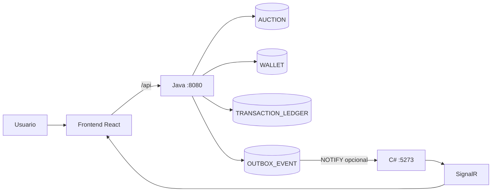

La analogía es una oficina: Java es el empleado autorizado a mover dinero; `OUTBOX_EVENT` es el libro donde anota qué ocurrió; C# es el mensajero que lee ese libro y avisa a las pantallas. El mensajero nunca vuelve a modificar la caja.

## 2. Regla de responsabilidades

| Componente | Puede leer | Puede escribir | Responsabilidad |
|---|---|---|---|
| Frontend | Respuestas HTTP y SignalR | No escribe la DB | Interfaz y acciones del usuario |
| Java | Toda la información necesaria | Operaciones de negocio y eventos | Wallet, pujas, ledger, liquidación y Outbox |
| C# | Datos compartidos y Outbox | Solo estado técnico de Outbox | Consumo, reintentos y SignalR |
| PostgreSQL | Todas las conexiones autorizadas | Aplica permisos y atomicidad | Persistencia y control de acceso |

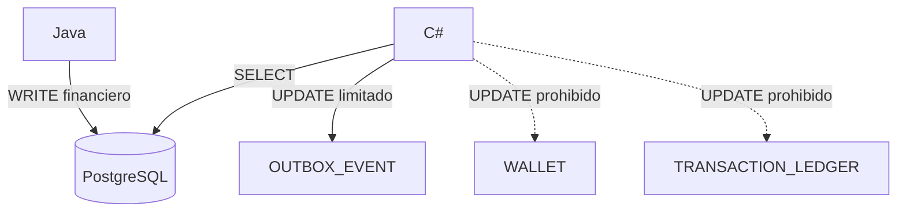

## 3. Commits realizados

### Commit `cc26565` — integración del frontend

Archivos bajo `./SubastaYA/`:

- `frontend/src/App.jsx`: coordina catálogo, wallet, creación y pujas.
- `frontend/src/Hooks/useCountdown.js`: calcula el tiempo restante.
- `frontend/src/Services/AuctionHub.js`: crea la conexión SignalR.
- `frontend/src/components/Auction/AuctionCard.jsx`: presenta una subasta.
- `frontend/src/components/Auction/AuctionCreationModal.jsx`: valida creación.
- `frontend/src/components/Auction/AuctionRoom.jsx`: presenta la sala de puja.
- `frontend/src/components/Wallet/Wallet.jsx`: consulta el saldo.
- `frontend/vite.config.js`: dirige `/api` hacia Java y `/hubs` hacia C#.

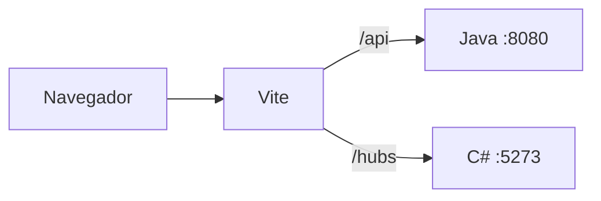

Vite no decide reglas de negocio: solamente deriva cada tipo de tráfico al backend correspondiente.

### Commit `c0682af` — persistencia Outbox

Archivos nuevos:

- `microservice-java/src/main/java/org/example/domain/entities/OutboxEvent.java`: entidad JPA que representa un evento pendiente, procesado o fallido.
- `microservice-java/src/main/java/org/example/domain/repositories/OutboxEventRepository.java`: repositorio para ordenar y consultar eventos.
- `microservice-java/src/main/java/org/example/service/OutboxEventService.java`: contrato `enqueue(...)`.
- `microservice-java/src/main/java/org/example/service/impl/OutboxEventServiceImpl.java`: serializa payload JSON y guarda el evento.

Archivo modificado:

- `microservice-java/src/main/resources/schema.sql`: crea `OUTBOX_EVENT` e índice por estado y fecha.

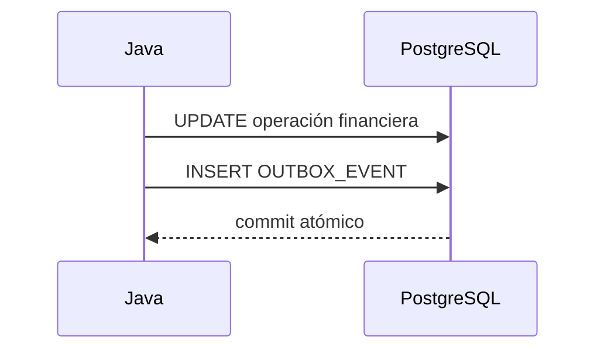

La Outbox evita el problema de modificar la wallet y perder luego la notificación.

### Commit `6fb491f` — eventos de wallet

Archivo:

- `microservice-java/src/main/java/org/example/service/impl/WalletServiceImpl.java`.

`depositFunds(...)` ahora registra `WalletBalanceChanged` después de guardar el saldo y el ledger. El payload contiene usuario, total, bloqueado, disponible y motivo.

### Commit `33e797c` — eventos de puja

Archivos:

- `microservice-java/src/main/java/org/example/service/impl/AuctionServiceImpl.java`.
- `microservice-java/src/main/java/org/example/service/impl/WalletServiceImpl.java`.

`placeBid(...)` genera `AuctionBidPlaced`, `OutbidNotification` y, si corresponde, `AuctionTimeExtended`. `processBidGuarantee(...)` genera `WalletBalanceChanged` para la devolución al usuario superado y para el bloqueo del nuevo líder.

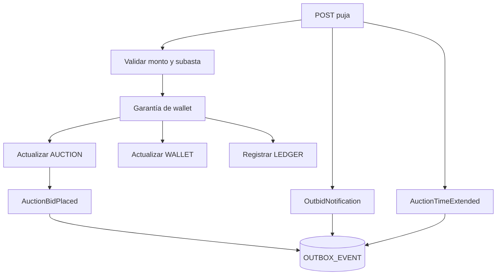

### Commit `43763b7` — consumidor Outbox en C#

Archivos:

- `backend/SubastaYa/SubastaYa.Api/Events/OutboxEventRecord.cs`: modelo de lectura.
- `backend/SubastaYa/SubastaYa.Api/Events/IOutboxEventHandler.cs`: contrato de procesamiento.
- `backend/SubastaYa/SubastaYa.Api/Events/OutboxEventConsumer.cs`: `BackgroundService` que consulta y procesa lotes.
- `backend/SubastaYa/SubastaYa.Api/Program.cs`: registra el consumidor.

Métodos relevantes de `OutboxEventConsumer`: `ExecuteAsync(...)` mantiene el ciclo; `ConsumeBatchAsync(...)` procesa lotes; `ReadPendingEventsAsync(...)` consulta; `TryStartProcessingAsync(...)` reclama; `MarkProcessedAsync(...)` confirma; `MarkFailedAsync(...)` registra error y reintento.

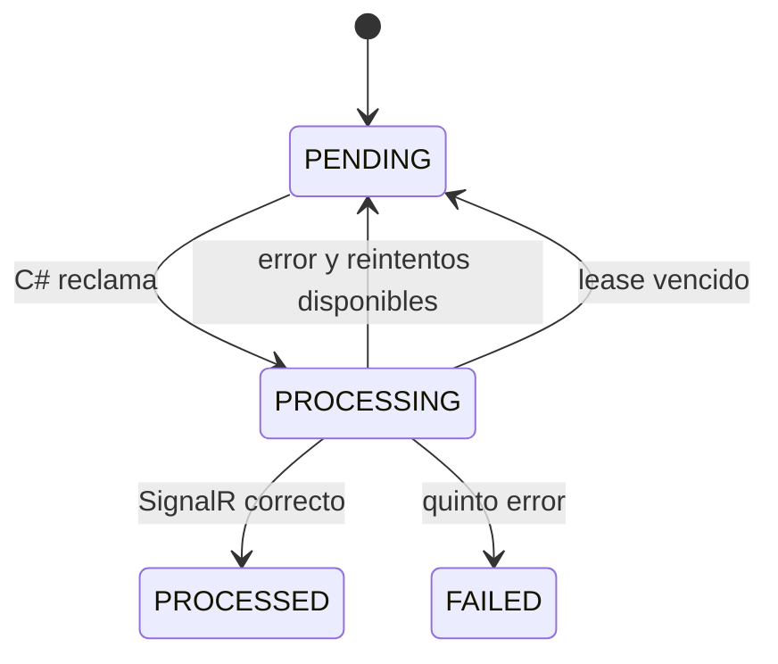

### Commit `ba21706` — Outbox hacia SignalR

Archivos:

- `backend/SubastaYa/SubastaYa.Api/Events/OutboxEventPublisher.cs`: deserializa JSON y selecciona la notificación.
- `backend/SubastaYa/SubastaYa.Domain/Interfaces/IAuctionHubClient.cs`: define mensajes para navegadores.
- `backend/SubastaYa/SubastaYa.Domain/Interfaces/IAuctionNotificationService.cs`: define operaciones de publicación.
- `backend/SubastaYa/SubastaYa.Api/Hubs/AuctionNotificationService.cs`: envía mensajes a grupos.
- `backend/SubastaYa/SubastaYa.Api/Hubs/AuctionHub.cs`: une conexiones a grupos de subasta y usuario.
- `frontend/src/Services/AuctionHub.js`: escucha eventos y reingresa después de reconectar.
- `frontend/src/Hooks/useAuctionSocket.js`: pasa el usuario al hub.

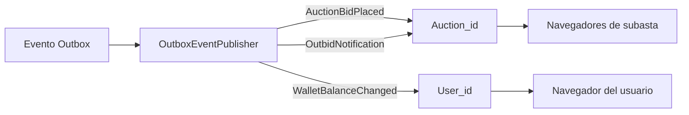

### Commit `b298b48` — reintentos y recuperación

Archivos:

- `backend/SubastaYa/SubastaYa.Api/Events/OutboxEventConsumer.cs`: máximo de cinco intentos y recuperación de `PROCESSING` antiguo.
- `microservice-java/src/main/java/org/example/domain/entities/OutboxEvent.java`: agrega `processingAtUtc`.
- `microservice-java/src/main/resources/schema.sql`: agrega `PROCESSING_AT_UTC`.

Un lease es como una tarjeta retirada de una bandeja: si el empleado desaparece durante más de cinco minutos, la tarjeta vuelve a estar disponible.

### Commit `4d3630c` — eliminación de duplicados C#

Se eliminaron:

- `backend/SubastaYa/SubastaYa.Api/Controllers/AuctionsController.cs`.
- `backend/SubastaYa/SubastaYa.Api/Controllers/BidsController.cs`.
- `backend/SubastaYa/SubastaYa.Api/Controllers/WalletsController.cs`.
- `backend/SubastaYa/SubastaYa.Domain/Interfaces/IBidService.cs`.
- `backend/SubastaYa/SubastaYa.Domain/Interfaces/IWalletService.cs`.
- `backend/SubastaYa/SubastaYa.Infrastructure/Services/BidService.cs`.
- `backend/SubastaYa/SubastaYa.Infrastructure/Services/WalletService.cs`.
- `backend/SubastaYa/SubastaYa.Api/Contracts/AuctionContracts.cs`.
- `backend/SubastaYa/SubastaYa.Api/Contracts/WalletContracts.cs`.

La razón es evitar dos entradas públicas que pudieran bloquear dinero o registrar una puja de forma distinta.

### Commit `6e811b6` — roles PostgreSQL

Archivos:

- `backend/SubastaYa/database/init/01-roles.sql`, reemplazado posteriormente por `01-roles.sh`.
- `backend/SubastaYa/docker-compose.yml`: monta el inicializador.
- `microservice-java/src/main/resources/application.properties`: conecta Java con `subastaya_java`.
- `backend/SubastaYa/SubastaYa.Api/appsettings.json` y `appsettings.Development.json`: preparan la conexión C#.
- `microservice-java/src/main/resources/schema.sql`: limita a C# a leer y actualizar solo columnas técnicas de Outbox.

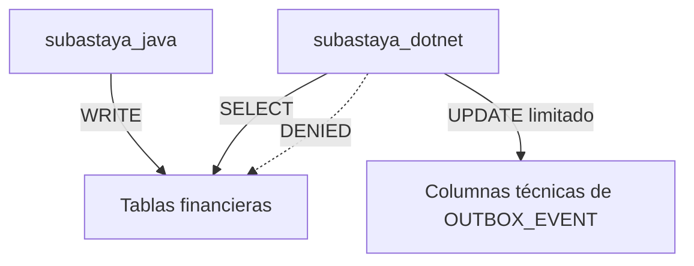

### Commit `c7376de` — PostgreSQL NOTIFY/LISTEN

Archivos:

- `microservice-java/src/main/java/org/example/service/impl/OutboxEventServiceImpl.java`: ejecuta `pg_notify(...)` dentro de la transacción.
- `backend/SubastaYa/SubastaYa.Api/Events/OutboxEventSignalListener.cs`: ejecuta `LISTEN subastaya_outbox`.
- `backend/SubastaYa/SubastaYa.Api/SubastaYa.Api.csproj`: agrega Npgsql.
- `backend/SubastaYa/SubastaYa.Api/Program.cs`: registra el listener.

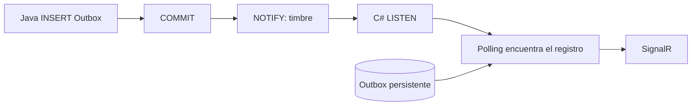

NOTIFY acelera la reacción, pero el polling sigue siendo necesario porque el timbre no guarda avisos para procesos apagados.

### Commit `341cfed` — identidad del pujador

Archivos:

- `backend/SubastaYa/SubastaYa.Domain/Interfaces/IAuctionHubClient.cs`.
- `backend/SubastaYa/SubastaYa.Domain/Interfaces/IAuctionNotificationService.cs`.
- `backend/SubastaYa/SubastaYa.Api/Hubs/AuctionNotificationService.cs`.
- `backend/SubastaYa/SubastaYa.Api/Events/OutboxEventPublisher.cs`.

`ReceiveNewBid(...)` ahora transmite `bidderId` separado del texto mostrado.

### Commit `d4e9228` — credenciales fuera del código

Archivos:

- `.env.example`: plantilla sin credenciales reales.
- `backend/SubastaYa/database/init/01-roles.sh`: crea roles usando variables entregadas por Docker.
- `backend/SubastaYa/docker-compose.yml`: consume variables del `.env`.
- `microservice-java/src/main/resources/application.properties`: usa variables de entorno.
- `backend/SubastaYa/SubastaYa.Api/appsettings.json` y `appsettings.Development.json`: no contienen passwords.

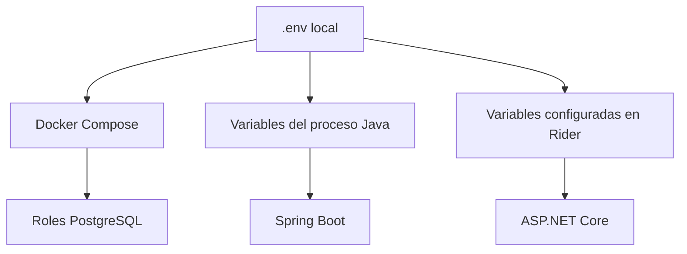

## 4. Configuración de variables

Copiar `.env.example` como `.env` y completar:

```text
POSTGRES_ADMIN_PASSWORD=...
SUBASTAYA_JAVA_PASSWORD=...
SUBASTAYA_DOTNET_PASSWORD=...
SUBASTAYA_DB_HOST=localhost
SUBASTAYA_DB_PORT=5432
SUBASTAYA_DB_NAME=subastaya_db
```

Para Docker Compose:

```text
docker compose --env-file .env -f backend/SubastaYa/docker-compose.yml up -d
```

Para Rider, configurar en el perfil C#:

```text
ConnectionStrings__DefaultConnection=Host=localhost;Port=5432;Database=subastaya_db;Username=subastaya_dotnet;Password=<valor de SUBASTAYA_DOTNET_PASSWORD>
```

Para Java, agregar al entorno de ejecución:

```text
SUBASTAYA_JAVA_PASSWORD=<valor de SUBASTAYA_JAVA_PASSWORD>
SUBASTAYA_DB_HOST=localhost
SUBASTAYA_DB_PORT=5432
SUBASTAYA_DB_NAME=subastaya_db
```

## 5. Rollback y atomicidad

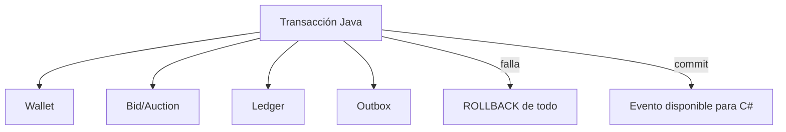

Java tiene el rollback de la operación financiera. C# solo puede revertir su procesamiento técnico y volver a intentar la notificación.

## 6. Verificaciones

- Java compila con sus clases y dependencias locales.
- Frontend pasa lint y build.
- Docker Compose valida su configuración con `.env`.
- Las credenciales reales no deben estar en commits nuevos.
- C# requiere el runtime de .NET 9 para completar el build.
