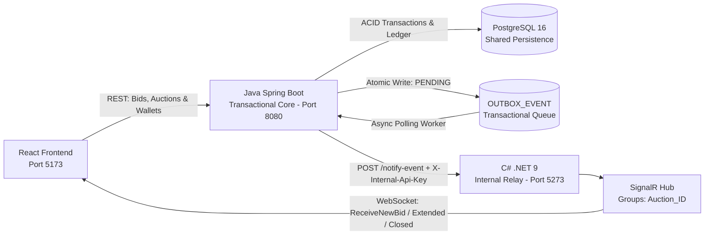
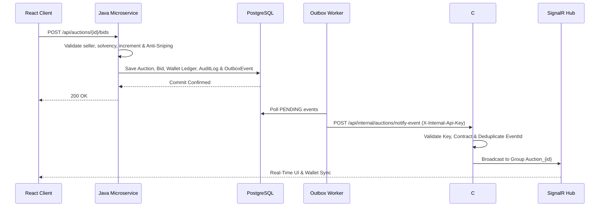

# SubastaYa - Real-Time Distributed Bidding Platform

A full-stack, real-time auction and electronic commerce platform built on a **polyglot distributed microservices architecture**. It features an ACID-compliant transactional core in Java, escrow-backed bidding guarantees, immutable double-entry financial accounting, dynamic anti-sniping protection, a transactional **Outbox Pattern** relay, and real-time WebSocket broadcasting via **C# SignalR**.

---

## System Architecture

SubastaYa separates core financial and transactional business logic from real-time pub/sub broadcasting:

* **Java (Spring Boot):** Acts as the transactional source of truth. Handles auction lifecycle, bid validation, seller self-bid prevention, `SERIALIZABLE` optimistic locking, Escrow wallet guarantees (`WalletServiceImpl`), Anti-Sniping extensions, background liquidation workers (`AuctionExpirationWorker`), and atomic Outbox event persistence (`OutboxService`).
* **Financial Integrity vs. Operational Auditing:**
  * `TRANSACTION_LEDGER`: Immutable accounting ledger recording every monetary state transition (`DEPOSIT`, `LOCK`, `REFUND`, `DEBIT`, `CREDIT`).
  * `AUDIT_LOG`: Operational and security trail (`AuditService`) logging business rule decisions such as rejected self-bids and anti-sniping timer extensions.
* **C# (.NET 9 + SignalR):** Acts as the internal messaging middleware and real-time relay. Exposes a secured internal webhook (`/api/internal/auctions/notify-event`), validates API keys (`X-Internal-Api-Key`), deduplicates events, and broadcasts state updates to isolated SignalR room groups (`Auction_{id}`).
* **PostgreSQL 16:** Shared relational persistence ensuring ACID guarantees across domain entities and the transactional Outbox table.
* **React 18 + Vite:** Real-time client featuring live UTC countdowns, dynamic bidding console, auction creation form, multi-user switcher, and live Escrow balance synchronization.



### End-to-End Bidding & Outbox Flow



---

## Tech Stack
* **Frontend:** React 18, Tailwind CSS, Vite, `@microsoft/signalr` WebSocket Client
* **Core Business Microservice:** Java 17, Spring Boot 3.2.3, Spring Data JPA, Hibernate ORM
* **Real-Time Middleware & Relay:** C# .NET 9, ASP.NET Core Web API, SignalR, Entity Framework Core
* **Database & Infrastructure:** PostgreSQL 16 (Containerized via Docker Compose)
* **Documentation & Contracts:** OpenAPI 3.0 / Swagger UI

---

## Getting Started

### 1. Prerequisites
Ensure you have the following installed on your machine:
* [Docker Desktop](https://docker.com)
* [Java Development Kit (JDK 17 LTS)](https://adoptium.net)
* [.NET 9 SDK](https://microsoft.com)
* [Node.js (LTS)](https://nodejs.org)

### 2. Database Setup (Docker & Seed Data)
The project relies on a containerized PostgreSQL instance (`subastaya_db`) operating on the standard `public` schema:

```bash
docker compose up -d
```

To perform a clean reset of the relational schema and re-seed baseline data:

```bash
docker compose down -v
docker compose up -d
```

> **Note:** The JPA persistence layer enforces `PhysicalNamingStrategyStandardImpl` and `globally_quoted_identifiers=true` to maintain strict uppercase naming consistency across Hibernate and PostgreSQL.

### 3. Running the Application
Run each service in a dedicated terminal instance:

**1. Java Transactional Microservice (Spring Boot):**
1. Open the `microservice-java` module in IntelliJ IDEA (or run via Maven).
2. Verify `application.properties` points to `jdbc:postgresql://localhost:5432/subastaya_db`.
3. Run `org.example.Main`.
* **Base URL:** `http://localhost:8080`
* **Swagger UI:** `http://localhost:8080/swagger-ui/index.html`

**2. C# SignalR Relay & Middleware (.NET 9):**
```bash
cd backend/SubastaYa.Api
dotnet ef database update
dotnet run
```
* **Base URL:** `http://localhost:5273`
* **SignalR Hub:** `http://localhost:5273/hubs/auction`
* **Swagger UI:** `http://localhost:5273/swagger/index.html`

**3. React Frontend Client:**
```bash
cd frontend
npm install
npm run dev
```
* **Web Client:** `http://localhost:5173`

---

## Mandatory Seed Data & Multi-User Demo Switcher
The database automatically seeds four test accounts and baseline auctions to validate solvency, escrow locking, self-bid blocking, and anti-sniping rules. You can switch between these accounts directly from the top navigation bar in the React UI:

* **Vendedor Demo (`ID: 1` - `vendedor@test.com`):** Seller account (Total Balance: `$0.00`). Used to create auctions and verify seller self-bid restrictions.
* **Comprador Uno (`ID: 2` - `comprador1@test.com`):** Leading bidder (Total: `$150,000.00` | Locked: `$45,000.00` | Available: `$105,000.00`).
* **Comprador Dos (`ID: 3` - `comprador2@test.com`):** Solvent bidder (Total: `$200,000.00` | Locked: `$0.00` | Available: `$200,000.00`).
* **Usuario Sin Fondos (`ID: 4` - `sinfondos@test.com`):** Insolvent account (Total: `$500.00` | Available: `$500.00`) designed to test Escrow rejections.

---

## Event Contracts (Java <-> C# <-> React)

| Java -> C# (`EventType`) | C# -> React (`SignalR Method`) | Real-Time Effect |
| :--- | :--- | :--- |
| `NewBid` | `ReceiveNewBid` | Updates current highest bid, leadership badge, bid feed, and Escrow balances. |
| `Extended` | `AuctionTimeExtended` | Extends `END_DATE_UTC` by `+2 minutes` when a bid arrives in the final 60 seconds. |
| `Closed` | `AuctionClosed` | Locks the bidding console, announces the winner, and settles wallet transfers (`DEBIT` / `CREDIT`). |

---

## Concurrency, Escrow & Outbox Stress Testing

To validate ACID consistency, `SERIALIZABLE` isolation, optimistic locking (`@Version`), and resilient event delivery, execute the following verified test suite against the running stack:

### TEST 1: Simultaneous Concurrency with Identical Amounts (Optimistic Locking)
Simulates two users (`ID 2` and `ID 3`) submitting identical bids (`$160,000.00`) within the same millisecond:

```bash
docker exec -i subastaya_db psql -U postgres -d subastaya_db -c "UPDATE \"WALLET\" SET \"AVAILABLE_BALANCE\" = 500000.00, \"TOTAL_BALANCE\" = 500000.00, \"LOCKED_BALANCE\" = 0.00 WHERE \"USER_ID\" IN (2, 3); UPDATE \"AUCTION\" SET \"STATUS\" = 'ACTIVE', \"CURRENT_PRICE\" = 100000.00, \"END_DATE_UTC\" = CURRENT_TIMESTAMP + INTERVAL '2 days', \"VERSION\" = 0 WHERE \"ID\" = 1;" && (curl -s -i -X POST http://localhost:8080/api/auctions/1/bids -H "Content-Type: application/json" -d '{"bidderId": 2, "amount": 160000.00}' & curl -s -i -X POST http://localhost:8080/api/auctions/1/bids -H "Content-Type: application/json" -d '{"bidderId": 3, "amount": 160000.00}' & wait)
```

* **Verified Result:** One thread commits (`HTTP 200 OK`, incrementing entity `version`), while the colliding thread fails serialization and is mapped to `HTTP 409 Conflict`.

---

### TEST 2: Escrow Guarantee Rejection (Insufficient Balance)
Evaluates an insolvent bidder (`USER_ID = 4` with `$500.00` available) attempting to bid `$150,000.00`:

```bash
docker exec -i subastaya_db psql -U postgres -d subastaya_db -c "UPDATE \"WALLET\" SET \"TOTAL_BALANCE\" = 500.00, \"AVAILABLE_BALANCE\" = 500.00, \"LOCKED_BALANCE\" = 0.00 WHERE \"USER_ID\" = 4; UPDATE \"AUCTION\" SET \"STATUS\" = 'ACTIVE', \"CURRENT_PRICE\" = 100000.00, \"END_DATE_UTC\" = CURRENT_TIMESTAMP + INTERVAL '2 days' WHERE \"ID\" = 1;" && curl -i -X POST http://localhost:8080/api/auctions/1/bids -H "Content-Type: application/json" -d '{"bidderId": 4, "amount": 150000.00}'
```

* **Verified Result:** `HTTP 400 Bad Request` (`Insufficient available balance to cover the bid amount.`), leaving database state untouched.

---

### TEST 3: Anti-Sniping Rule (Automatic UTC Time Extension)
Tests a valid bid placed inside the critical 60-second window before auction expiration:

```bash
docker exec -i subastaya_db psql -U postgres -d subastaya_db -c "UPDATE \"WALLET\" SET \"AVAILABLE_BALANCE\" = 500000.00, \"TOTAL_BALANCE\" = 500000.00 WHERE \"USER_ID\" = 3; UPDATE \"AUCTION\" SET \"STATUS\" = 'ACTIVE', \"CURRENT_PRICE\" = 100000.00, \"END_DATE_UTC\" = CURRENT_TIMESTAMP + INTERVAL '45 seconds' WHERE \"ID\" = 1;" && curl -i -X POST http://localhost:8080/api/auctions/1/bids -H "Content-Type: application/json" -d '{"bidderId": 3, "amount": 150000.00}' && docker exec -i subastaya_db psql -U postgres -d subastaya_db -c "SELECT \"ID\", \"END_DATE_UTC\" AS \"NEW_EXTENDED_DATE\", \"CURRENT_PRICE\" FROM \"AUCTION\" WHERE \"ID\" = 1;"
```

* **Verified Result:** Java extends `END_DATE_UTC` by `+2 minutes`, logs the extension in `AUDIT_LOG`, and enqueues both `NewBid` and `Extended` events to broadcast the live timer update via SignalR.

---

### TEST 4: Escrow Fund Release & Wallet Clearing (Outbid Flow)
Verifies atomic escrow lock (`LOCK`) and automatic release (`REFUND`) when a leading bidder is outbid:

```bash
docker exec -i subastaya_db psql -U postgres -d subastaya_db -c "UPDATE \"WALLET\" SET \"AVAILABLE_BALANCE\" = 500000.00, \"TOTAL_BALANCE\" = 500000.00, \"LOCKED_BALANCE\" = 0.00 WHERE \"USER_ID\" IN (2, 3); UPDATE \"AUCTION\" SET \"STATUS\" = 'ACTIVE', \"CURRENT_PRICE\" = 100000.00, \"END_DATE_UTC\" = CURRENT_TIMESTAMP + INTERVAL '2 days', \"CURRENT_WINNER_ID\" = NULL WHERE \"ID\" = 1;" && curl -i -X POST http://localhost:8080/api/auctions/1/bids -H "Content-Type: application/json" -d '{"bidderId": 2, "amount": 150000.00}' && sleep 1 && curl -i -X POST http://localhost:8080/api/auctions/1/bids -H "Content-Type: application/json" -d '{"bidderId": 3, "amount": 160000.00}' && docker exec -i subastaya_db psql -U postgres -d subastaya_db -c "SELECT \"USER_ID\", \"TOTAL_BALANCE\", \"AVAILABLE_BALANCE\", \"LOCKED_BALANCE\" FROM \"WALLET\" WHERE \"USER_ID\" IN (2, 3) ORDER BY \"USER_ID\";"
```

* **Verified Result:** User `2` recovers full liquidity (`AVAILABLE_BALANCE = 500000.00`, `LOCKED_BALANCE = 0.00`) via a `REFUND` ledger entry, while User `3` has `$160,000.00` retained in `LOCKED_BALANCE`.

---

### TEST 5: Transactional Outbox & Java-to-.NET Event Relaying
Verifies that bids persist an atomic event in `OUTBOX_EVENT` and the scheduled worker dispatches it to C# (`POST /api/internal/auctions/notify-event` with `X-Internal-Api-Key`):

```bash
curl -i -X POST http://localhost:8080/api/auctions/1/bids -H "Content-Type: application/json" -d '{"bidderId": 2, "amount": 170000.00}' && sleep 6 && docker exec -i subastaya_db psql -U postgres -d subastaya_db -c "SELECT \"EVENT_ID\", \"EVENT_TYPE\", \"STATUS\", \"ATTEMPTS\" FROM \"OUTBOX_EVENT\" ORDER BY \"CREATED_AT_UTC\" DESC LIMIT 5;"
```

* **Verified Result:** Java dispatches the `PENDING` event to port `5273`, C# responds with `202 Accepted` and broadcasts via SignalR, and the event transitions to `SENT` (`ATTEMPTS = 1`).

---

### TEST 6: Outbox Resilience & Retry Recovery (C# Downtime Simulation)
Demonstrates zero event loss when the .NET relay service is temporarily offline:

1. Stop the C# backend (`Ctrl + C` on `dotnet run`).
2. Insert a pending event into `OUTBOX_EVENT`:

```bash
docker exec -i subastaya_db psql -U postgres -d subastaya_db -c "INSERT INTO \"OUTBOX_EVENT\" (\"EVENT_ID\", \"EVENT_TYPE\", \"AGGREGATE_ID\", \"PAYLOAD_JSON\", \"STATUS\", \"ATTEMPTS\", \"NEXT_ATTEMPT_AT\", \"CREATED_AT_UTC\") VALUES (gen_random_uuid(), 'NewBid', 1, '{\"EventId\": \"f47ac10b-58cc-4372-a567-0e02b2c3d479\", \"AuctionId\": 1, \"EventType\": \"NewBid\", \"NewAmount\": 180000, \"BidderId\": 2, \"BidderUsername\": \"User_2\", \"EventTimestampUtc\": \"2026-11-12T18:00:00Z\"}', 'PENDING', 0, NOW(), NOW());"
```

3. Verify Java catches the connection failure, increments `ATTEMPTS`, and schedules `NEXT_ATTEMPT_AT` with exponential backoff without rolling back the bid.
4. Restart C# (`dotnet run`) and confirm the worker automatically delivers the queued event and marks it as `SENT`.

---

### TEST 7: Internal Webhook Security & Contract Validation (`401` & `400`)
Validates that C# protects `/api/internal/auctions/notify-event` against unauthorized callers and malformed payloads:

```bash
# 1. Invalid or missing API Key -> Verified: 401 Unauthorized
curl -i -X POST http://localhost:5273/api/internal/auctions/notify-event -H "Content-Type: application/json" -H "X-Internal-Api-Key: wrong-key" -d '{}'

# 2. Unsupported EventType -> Verified: 400 Bad Request
curl -i -X POST http://localhost:5273/api/internal/auctions/notify-event -H "Content-Type: application/json" -H "X-Internal-Api-Key: java73" -d '{"EventId": "a2936cac-79a6-4d33-9473-8963b90e75e9", "AuctionId": 1, "EventType": "SuperBidInvalidType", "NewAmount": 99999, "BidderId": 1, "BidderUsername": "HackerMan", "EventTimestampUtc": "2026-11-12T18:00:00Z"}'
```

---

## Authors
* **Mateo Agustín Valencia Cortez**
* **Mía Valentina Politano**

## License
This project is intended strictly for academic and private evaluation (Universidad Nacional Arturo Jauretche).